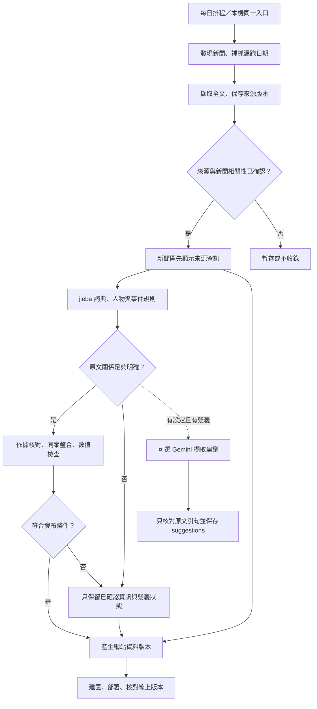

# 酒駕與毒駕每日新聞自動更新規劃

更新日期：2026-11-03，Asia/Taipei。狀態：jieba、酒精／毒品規則、新聞／事件快照核對及 GitHub 發布流程已實作，尚未部署。原文回看與例外修正持續進行；這不表示精確率已量測或全自動語意理解已完成。現行決策見 [ADR-0002](adr/0002-automatic-news-publication.md)，可執行的安裝、CLI 與發布操作以 [README](../README.md#每日酒駕與毒駕新聞) 為準。

## 需求與取代關係

- 同時收錄酒駕與毒駕新聞，減少人工介入，每日由 GitHub Actions 執行並直接更新網站。
- 允許自然語言處理、免費 API 或本機規則；先前「不得呼叫模型 API」及「每批必須人工合併資料 PR」已由最新需求取代。
- 保留本機與 Actions 共用程式、README 提供可執行指令、原文依據、人物與事件關聯、零死傷具體上路事件，以及未知傷亡不填零的要求。酒駕與毒駕都沿用具體上路口徑。
- 先完成方法及腳本，再用舊聞與近期文章回看，最後才將穩定行為固定為回歸檢查。本輪不新增或執行爬蟲測試。
- Q6 已確認「具體事件＋相關新聞分區」：具體事件符合條件才進地圖，政策、判決與統計另放新聞區。
- Q7 已確認「新聞先發布，疑義欄位暫緩」：已確認相關的文章可先顯示來源標題、連結及待釐清狀態；未確認資訊不進地圖／統計。同案數值衝突保留既有已核對值，集中列出例外；沒有原值時保持未明。這也解決舊 Q5，不需重問。

## 已實作的流程與發布界線

下圖描述程式流程；最後的建置、部署與線上讀回尚未在正式環境完成。



Node 負責擷取、事件規則、快照與發布，Python 承擔 jieba 斷詞。`news_understanding.mjs` 產生事件及候選，`news_records.mjs` 另行決定發布與欄位資格。Gemini 建議使用獨立的 suggestions 結構，不合併成已核對事件，也不改變發布資格。未引入向量資料庫或常駐服務。

## 實作狀態與仍需驗證的部分

以下取代初次規劃時的缺口清單，描述目前 worktree 的實作；不代表已發布到正式網站。

| 位置 | 已實作與限制 |
|---|---|
| `scripts/news_tokenizer.mjs`、`tokenize_news.py` | 接入 jieba 0.42.1、隨庫繁體基底與領域詞典，固定 `HMM=false`；驗證基底 checksum，記錄複合 `dictionaryHash`，核對 JS UTF-16 原文位置。切詞不等於人物關係核對。 |
| `scripts/news_understanding.mjs` | 分別產生酒精／毒品主張、當事人、上路經過、時間、地點與傷亡；酒精數值附單位及檢體資訊。人物指代、否定、多案及新句型仍需原文回看。 |
| `scripts/update_news.mjs`、`ltn_article.mjs` | 多關鍵字發現、已見 URL 重取、正文版本雜湊、日期水位與離線重播已接入。整批核對後才產生 ready manifest；無法宣稱涵蓋所有新聞。 |
| `scripts/news_records.mjs` | 分開新聞卡、事件與欄位資格；同案保留 ID、來源與 history，疑似只進新聞；未知傷亡不補零。既有人工修改保留，未核對 legacy 值不自動成為統計依據。 |
| `src/App.jsx`、`index.html` | 接入酒／毒篩選、新聞分區、事件日期、零死傷事件、缺值與機器／人工核對狀態；正式資料與頁面仍待部署驗收。毒品嫌疑犯背景資料不能視為酒駕風險指標。 |
| `scripts/update_news_pr.sh` | 舊 `news:pr` 已停用並提供遷移指引；拒收 URL 可延續至 state，舊未合併資料 PR 不自動吞入新流程。 |
| `scripts/publish_news.mjs`、新聞與部署 workflows | 精確快照上傳／dispatch、`news-data` 持久保存、共同發布鎖、部署重試及三份公開 JSON hash 讀回已實作。正式部署、遠端權限與環境設定仍待驗收。 |

初次規劃盤點的 85 筆舊資料中，61 筆同時標記待複核與納入統計；這是遷移前狀態，不是目前快照結果。實作保留舊 ID、內容與人工修訂，以 report 揭露核對前後統計數、`excludedLegacyCount` 及欄位變更。未核對 legacy 值遇到強證據新值可重新核對並留下 `rechecked_legacy_value`；新值仍未明時，舊值只能供查閱，不能當成已核對數值。遠端分支保護、Pages 環境核准與 API 帳戶條件仍須在正式使用前確認。

## NLP 選擇與免費條件

下表保留初次選型範圍，並標示目前採用狀態；不是本輪重新查證供應商額度。免費條件與模型供應須以實際帳戶核對，不承諾每天固定篇數。

| 方案 | 可處理的工作 | 代價與採用建議 |
|---|---|---|
| jieba＋專用詞典＋規則 | 詞彙位置、常見人物指代、否定、檢測與數值句型 | 已接入主要流程；複雜句型仍需維護規則。jieba 是斷詞工具，不是完整事件理解器。 |
| CKIP Transformers 本機模型 | 斷詞、詞性、人名地名等實體辨識 | 官方提供 CPU 執行方式，仍需模型下載及資源；人物實體不等於駕駛／受害者關係。先列備選，不與 jieba 同時全面導入。 |
| Gemini API | 附原文引句的角色／關係 suggestions | 可選接點已實作；未設定金鑰、未實測 API，也未量測效果。須自行核對模型的免費層與資料使用條件。 |
| Cloudflare Workers AI | 可選開源模型的文字擷取 | 保留為原選型備案，未接入；未建立多供應商自動切換。 |

來源：[jieba](https://github.com/fxsjy/jieba)、[CKIP Transformers](https://github.com/ckiplab/ckip-transformers)、[Gemini 定價](https://ai.google.dev/gemini-api/docs/pricing)、[Gemini 額度](https://ai.google.dev/gemini-api/docs/rate-limits)、[Workers AI 定價](https://developers.cloudflare.com/workers-ai/platform/pricing/)。

規則先處理全部文章。有未解關係且設定 `GEMINI_API_KEY`、`GEMINI_MODEL` 時，可選接點送出文章標題、正文與疑義清單，要求附連續原文引句的 suggestions。程式只核對結構、引句及主客體字串是否存在並記錄位置，標記 `quote_checked_relation_unverified`；不宣稱已驗證其人物歸屬、否定、數值或事件範圍。建議保留供回看，不改變 eligibility、不覆寫傷亡，模型信心也不是發布依據。

API 沒有任意改檔、搜尋人物或執行指令的能力；新聞內容只作資料，輸出限固定結構。金鑰使用 Actions secrets／本機環境。快取按正文雜湊、標題、模型與提示版本建立；`NEWS_API_MAX_REQUESTS` 是每次執行的請求上限，預設 10，0 為不發請求。state 的日期與累計 requests 供記錄使用，不是跨執行的每日硬額度；不自動升級付費或輪換帳戶規避限額。

缺少 API 設定時走停用路徑；額度不足或 API 故障時記錄狀態，不阻擋可獨立通過核對的本機結果，疑義也不因此被升格。目前沒有金鑰或 API 實測證據。必要斷詞程式、詞典或共同資料驗證故障則停止整次資料發布，保留既有網站，符合 Q3 的故障處理要求。

## 擷取、理解與同案更新

1. **找新聞**：第一版沿用已有 LTN 擷取接點，加入酒駕、酒後駕車、酒測、拒測等發現詞；毒駕同時包含檢測／毒品相關詞。關鍵字只是候選篩選，單獨拒測或毒品名稱不構成收錄證據。多媒體來源下一步逐站核對 RSS、使用條件與全文擷取，不宣稱單一來源涵蓋全台新聞。
2. **保留文章版本**：儲存 URL、標題、發布日、正文雜湊與理解版本，執行報告另記檢查時間及結果。已見 URL 仍重取並以 hash 辨識正文變更，不假定已取得來源的完整改稿時間線。公開站點以來源連結及必要摘要呈現，不直接將完整新聞批次再發布。
3. **分句與斷詞**：jieba 繁體詞典加專用詞彙，固定 `HMM=false`；對來源 adapter 輸出的 title／body 保留 UTF-16 位置並核對原文切片。基底 checksum 與複合 `dictionaryHash` 使版本可追溯，不把詞界核對當成語意效果比較，也不把切出的詞自動升格為毒品事實。
4. **分案與人物**：先隔開一篇內的多起案件，再連接人物稱謂、角色、車輛、駕駛行為及檢測。跨句回指需符合別稱與角色限制，不只選最近的姓名；同姓多人不強行合併。
5. **酒精與毒品分別判讀**：每項主張記錄當事人、物質類別、方法、檢體、數值／單位、狀態、時間及原文。酒精與毒品不互斥，須分清同一駕駛兩者均涉及，或同案不同駕駛分別涉及。
6. **傷亡與日期**：事發日和發布日分開；死亡、存活傷者、未明人數分開。事故總數、歷年統計、年齡與車輛數不混算。只有原文明確指出同一人由受傷轉為死亡，才能進行對應狀態更新，不一律把傷者減一。
7. **跨篇同案**：先以日期、具體地點、人物／車輛和明確回指產生候選，再排除矛盾；禁止只靠相同縣市、姓氏、傷亡數或標題相似度自動合併。新報導掛到穩定事件 ID，同案資訊有時間序列與來源；不明配對不另外建立可能重複的統計事件。

實作使用詞典比對、句型／否定範圍規則、人物別稱約束、事件關係連結及有明示訊號的狀態更新；可選 API 另存供回看的建議。數值與事件合併仍由共同規則控制。歷史新聞是修正詞彙與句型的材料，不會自動訓練出可保證正確的語意模型。

| 例子（示意，非真實新聞引文） | 預期結果 |
|---|---|
| 陳男駕車撞護欄，警方表示涉酒駕，呼氣酒測 0.48 mg/L | 酒精主張綁定陳男；保存呼氣、數值與單位，不能改成血液檢測或逕稱法院定罪。 |
| 駕駛酒測為零，乘客包包查獲毒品 | 不成立駕駛酒精陽性或毒駕；乘客持有不能移給駕駛。 |
| 排除酒駕，毒品檢測仍待結果 | 酒精排除、毒品待驗分開，不能都標為陽性。 |
| 初報三人受傷，後報明指其中一人不治 | 同案且人物／總數範圍一致時更新為一死二名存活傷者，保留前後來源。 |
| 同案新報人數不同，沒有說明更正或變化 | 保留既有已核對值與來源，衝突值暫不覆寫，集中記錄例外；沒有原值時保持未明。 |

## 新聞、事件及網站統計

最低限度將「文章」與「事件」分開；人物及證據可以內嵌事件，現階段不需獨立資料庫。

- 文章：來源、發布日期、版本、類型、關聯事件與處理狀態。一篇可有多案，一案可有多篇。
- 事件：穩定 ID、事發時間及精度、地點及精度、當事人、酒精／毒品主張、傷亡、來源和變更依據。
- 狀態：機器規則核對、人工核對、待釐清分開；機器通過不偽裝成曾有人審查，新聞報導也不等於司法認定。
- 篩選：全部、酒駕、毒駕、同案涉及兩者；兩分類可重疊，全部事件總數按事件 ID 去重，不把分類數直接相加。
- 新聞區：包含具體事件及另行分類的政策、統計、司法報導；文章不因日期新就形成新事故。同案司法報導可連到舊事件。現行 `policy`／`statistics` 固定只產生新聞卡，不用其中的假設駕駛、法律死傷或統計數字新增／更新事件；混合文章的例外處理留待後續。
- 地圖／統計：事件關係與定位達條件才入圖，只有城市時不捏造事故座標；精度不足可留縣市彙總。未知傷亡可顯示「未明」，不填零；總數另揭露缺值事件數。疑似與明確報導分層呈現。

新聞公開先確認來源有效及內容確與酒駕／毒駕相關，不能把單純命中關鍵字或擷取失敗的頁面自動公開。原文關係尚未釐清時只顯示來源標題、連結及待釐清狀態，不產生未核對的事實摘要。擷取失敗與真正沒有新聞是兩種狀態。

事件資料另要求具體上路經過、駕駛關聯明確、事發日可核對、類型有強證據、同案判斷無未解身分矛盾及資料驗證通過；候選不等於已發布事件。`suspected` 只進新聞；`reported_positive_or_use`／`reported` 仍須通過主張、人物與原文核對。位置與傷亡數值各自核對，未知傷亡不阻擋已確認事件的事件數；`needsHumanReview` 也不能單獨取代事件與欄位資格。

| 已知情況 | 新聞區 | 地圖／事件數 | 傷亡統計 |
|---|---|---|---|
| 事件、位置及傷亡都有依據 | 自動發布 | 通過事件與位置核對後採用 | 採用可核對數值 |
| 事件與位置明確，傷亡未明 | 發布並標示未明 | 可進地圖與事件數 | 未明欄位不加總，揭露缺值 |
| 事件身分或酒／毒駕關聯有歧義，但文章相關性已確認 | 來源資訊先發布、標示待釐清 | 歧義未解前不新增事件或位置 | 不採用未確認數值 |
| 同案新數值與既有已核對值衝突 | 發布新來源及待釐清狀態 | 不新增重複事件；不影響已確認位置 | 保留既有已核對值，另存衝突依據 |
| 政策、判決、統計報導 | 另類別發布 | 不直接新增事件；同案後續可連結既有事件 | 不將報導的全國或歷年總數加入個案加總 |

待釐清項目按文章版本、事件與欄位去重；新原文或後續消息到來時再自動判讀，只有仍無法解決的例外需要集中處理。未確認位置不以縣市中心偽裝成精確事故座標。

## 每日執行與部署

workflow 已設定每日 00:17 Asia/Taipei 主排程與 08:17 補跑檢查；當日已發布驗證且水位涵蓋昨日才略過補跑。收集最近七個已結束的台北日曆日，漏跑缺口每次最多補七天，水位沿連續成功日期前進。這是已實作設定，尚未部署運行，也不代表能找到所有延遲報導。

已實作順序：取回上次成功資料 → 擷取與判讀 → 產生待發布快照 → 共同資料檢查 → 建置 → 保存版本 → 部署指定快照 → 線上讀回版本及資料雜湊。`news-data` 分支持久保存三份公開 JSON、state、manifest 與發布 metadata；全文 sources 與完整 analysis 僅留於本機回看產物。本機 publisher 上傳精確快照後 dispatch 同一 workflow；程式碼仍走原有變更流程。

排程與手動執行共用同一發布鎖；失敗不清空既有資料，已建置但未部署成功的版本留待重試。抓取成功位置與網站發布成功版本分開，避免部署失敗後永久漏掉已抓取新聞。網站分別顯示最近檢查時間、最近資料變更時間與發布版本；沒有新文章仍可證明曾成功檢查。

發布器採明確 dispatch 與同一 workflow 的部署步驟，不依賴資料分支 push 自動觸發另一個 workflow。成功條件包含線上三份公開 JSON hash、程式 commit SHA 與快照 ID 讀回；本機 `Submitted` 僅表示已送出。原設計依據見 [官方觸發文件](https://docs.github.com/en/actions/how-tos/write-workflows/choose-when-workflows-run/trigger-a-workflow)。

GitHub 排程可能延遲，負載高時也可能漏執行；公開 repository 長期沒有活動可能停用排程。補跑降低漏跑影響，但不能當成獨立監測。第一版提供線上資料時間與 Actions 失敗狀態；若要求逾時主動通知，再接獨立監測服務，不用 Codex 排程充當守護程序。[官方 schedule 文件](https://docs.github.com/en/actions/reference/workflows-and-actions/events-that-trigger-workflows#schedule)

## 完成證據與待辦

1. **詞彙與事件資料**：實作及介面見 [理解方法](news-understanding-method.md) 與 [詞典契約](../scripts/lexicon/README.md)。固定版本、原文切片及 hash 可驗證重現性，不能證明語意精確率。
2. **發布資格與遷移**：以 records 的 report／state 檢查舊 ID、人工修訂、同案來源、欄位更正、衝突與統計差異；不把舊萃取結果當答案。更正或同一人傷亡轉變須有明示原文及 `updateKind`／`currentFacts`，沒有訊號時不按較新日期或最大值覆寫。
3. **原文回看**：逐篇結果由 [回看報告](news-understanding-backtest-2026-11-03.md) 維護，本頁不複製會變動的樣本數或結果。用於調整規則的材料不是未見資料；精確率、漏收率與泛化能力仍需獨立取樣及按同案分組的評估。
4. **正式發布**：GitHub publisher、排程、恢復與線上 hash 核對已寫入程式，尚未部署。需完成正式環境設定、快照／建置核對、首次部署及線上讀回，才能記為發布完成。
5. **可選 API**：僅 suggestions 路徑已實作；沒有金鑰、API 實測或模型效果證據，不將停用路徑可執行當成雲端驗收。

CLI 真實來源是 [README：安裝、抓取／重播、發布與故障恢復](../README.md#安裝本機新聞環境) 及各命令的 `--help`；本頁不再保留早期的擬定命令。`news:update`／`news:replay` 預設只產生快照；正式發布由 `news:publish` 另行執行，離線重播發布還需明示 `--allow-replay`。

## 已確認的訪談決策與技術待辦

```text
已定：酒駕＋毒駕、每日自動更新網站、允許免費 API／規則
├─ 延續：jieba 詞典、人物／事件關係、本機共用、必要環境故障停止
├─ Q6：新聞內容範圍【已確認】
│  └─ 具體事件符合條件進地圖，政策／判決／統計另放新聞區
├─ Q7：有疑義資訊的發布界線【已確認；一併解決舊 Q5】
│  ├─ 已確認相關的新聞先顯示來源標題／連結，疑義欄位暫緩
│  └─ 既有已核對數值遇不明衝突保留原值，集中記錄例外
└─ 實作已接入：HMM=false、詞典 hash、酒／毒規則、records、GitHub publisher
   └─ 待驗證：持續原文回看、正式部署讀回；可選 Gemini 尚無 API 實測
```

收錄與發布決策已收斂，Q5／Q6／Q7 均已解決。HMM=false 是目前實作設定，並非把早期詢問語料來源追溯解讀為當時已選定開關；詞界穩定不表示已完成不同 HMM 設定的語意效果比較。

可選接點已選用 Gemini，實際模型由 `GEMINI_MODEL` 指定並需核對帳戶條件；未授權付費、未建立金鑰、未量測 API 效果。新聞理解仍需處理例外，不承諾完全零人工。
